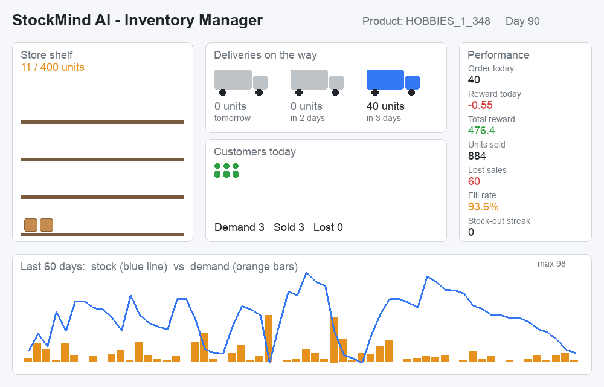
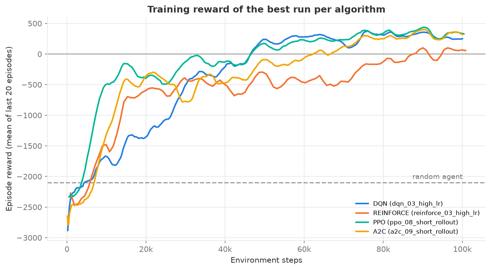

# StockMind AI: Reinforcement Learning for Retail Inventory

An RL agent that decides **how many units to order each day** for a store, using
real Walmart demand (Kaggle M5 Forecasting, store CA_1, HOBBIES category, 10 best-selling items).
Four algorithms are trained and compared with **TorchRL** on the same custom Gymnasium environment:
**DQN** (value-based), **REINFORCE**, **PPO** and **A2C** (policy-gradient).



## Quick start

```bash
git clone https://github.com/Dankagame/YOUR_NAME_rl_summative.git
cd YOUR_NAME_rl_summative
uv sync
uv run main.py                 # best agent (PPO), 3 episodes, pygame window + terminal log
```

Other options:

```bash
uv run main.py --algo dqn          # best DQN / reinforce / ppo / a2c agent
uv run main.py --algo random       # random agent, for comparison
uv run main.py --fps 3             # slower simulation
uv run main.py --no-render         # terminal only
```

## The problem

Every day the store manager chooses an order size. Orders arrive **3 days later**.
Ordering too little loses customers; ordering too much fills the shelf and costs storage.
Because today's order only affects stock 3 days from now, this is a **sequential decision
problem with delayed consequences**, which is why RL is used instead of a one-step forecast.

## Environment (`environment/custom_env.py`)

| Element | Definition |
|---|---|
| **Actions** (Discrete 6) | Order 0, 5, 10, 20, 40 or 80 units (a real purchase order) |
| **Reward** (per day) | +1 per unit sold, −0.05 per unit held, −2 per lost sale, −1 per wasted unit (shelf over 400), −3 per order placed |
| **Start state** | Random product, random start day, random starting stock (0 to 2 × recent daily sales × lead time), no orders on the way |
| **Terminal** | Truncated after 90 days; terminated early after 14 stock-out days in a row |
| **Data split** | First 80% of days for training, last 20% (unseen) for testing |

### Observations (11 values, all scaled to [0, 1])

| # | Meaning | Encoding / range | Source | Updated |
|---|---|---|---|---|
| 0 | Stock on hand | units / 400 | Simulation (after sales and deliveries) | Daily |
| 1 | Units on the way | sum of open orders / 400 | Simulation (order pipeline) | Daily |
| 2 | Units arriving tomorrow | units / 80 | Simulation (order pipeline) | Daily |
| 3 | Average sales, last 7 days | units / 50 | M5 `sales_train_validation.csv` | Daily |
| 4 | Average sales, last 28 days | units / 50 | M5 `sales_train_validation.csv` | Daily |
| 5 | Yesterday's sales | units / 50 | M5 `sales_train_validation.csv` | Daily |
| 6 | Day of week | (wday − 1) / 6 | M5 `calendar.csv` | Daily |
| 7 | Event / holiday today | 0 or 1 | M5 `calendar.csv` (`event_name_1`) | Daily |
| 8 | SNAP day today (CA) | 0 or 1 | M5 `calendar.csv` (`snap_CA`) | Daily |
| 9 | Selling price | price / max price | M5 `sell_prices.csv` | Weekly |
| 10 | Episode progress | day / 90 | Simulation | Daily |

All values go into the agent's neural network as one float vector each day.

## Project structure

```
├── main.py                  # run the best trained agent (GUI + terminal)
├── environment/
│   ├── custom_env.py        # Gymnasium environment
│   └── rendering.py         # pygame visualization
├── training/
│   ├── dqn_training.py      # DQN, 10 hyperparameter experiments
│   ├── pg_training.py       # REINFORCE, PPO, A2C, 10 experiments each
│   └── plot_results.py      # report figures
├── models/dqn, models/pg    # 40 trained models (.pt)
├── logs/                    # training curves (.json) and results tables (.csv)
├── assets/plots/            # report figures
├── data/processed/          # selected_products.csv (environment data)
└── src/stockmind_ai/        # data preparation scripts (M5 → selected_products.csv)
```

## Reproduce the training

```bash
uv run python training/dqn_training.py --runs all              # 10 DQN runs (~10 min)
uv run python training/pg_training.py --algo all --runs all    # 30 PG runs (~15 min)
uv run python training/plot_results.py                         # figures → assets/plots/
```

Rebuilding the dataset from scratch requires the M5 files from Kaggle (join the competition first)
placed in `data/raw/`, then:

```bash
uv run python src/stockmind_ai/prepare_data.py
uv run python src/stockmind_ai/select_products.py
```

## Results (unseen test period, 20 episodes, greedy policy)

| Algorithm | Best run | Test reward | Steps to break-even |
|---|---|---|---|
| Random agent | — | ≈ −2,100 | never |
| **PPO** | ppo_08_short_rollout | **388.1** | 47k |
| DQN | dqn_03_high_lr | 378.6 | 47k |
| A2C | a2c_09_short_rollout | 318.5 | 62k |
| REINFORCE | reinforce_03_high_lr | 42.7 | 88k |

The trained agents learn a reorder-point policy: they keep about 50 units on the shelf and order
40 units when stock plus deliveries on the way runs low, serving about 96% of customers.
The random agent keeps over 300 units and loses money.


